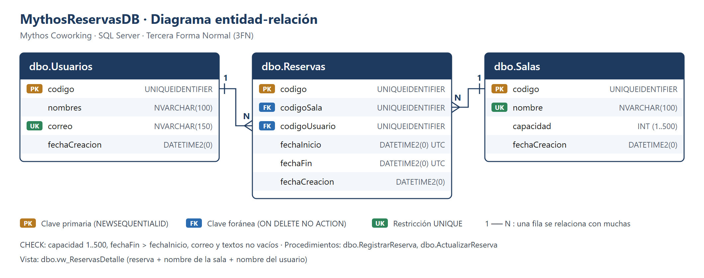
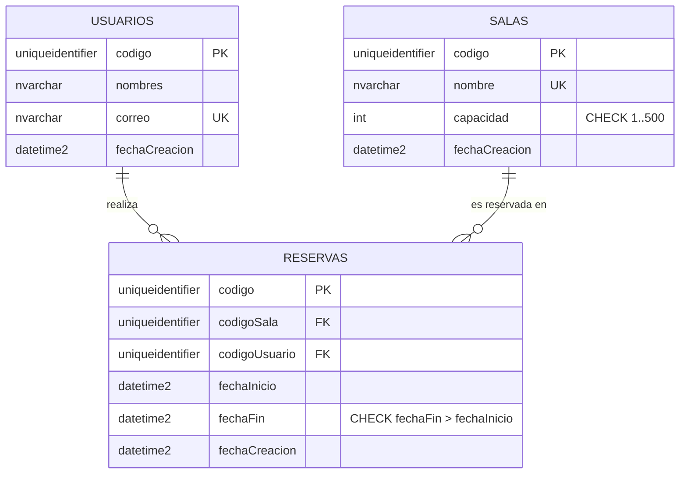

# EP-Backend_BBDD · Base de datos SQL Server

Repositorio **2 de 3** de **Mythos Coworking · Sistema de Gestión de Reservas**. Contiene los scripts de
SQL Server: la estructura (DDL), la carga inicial (DML) y el diagrama de la base de datos.

| Repositorio | Contenido |
| --- | --- |
| [EP-Backend](https://github.com/TheDanielrity/EP-Backend) | API REST con Node.js + Express |
| **EP-Backend_BBDD** (este) | SQL Server: tablas, índices, vista, procedimientos almacenados y datos |
| [EP-Backend_MongoDB](https://github.com/KlausGatjens/EP-Backend_MongoDB) | MongoDB: esquemas de logs y comentarios y su carga inicial |

> Evaluación Parcial · Desarrollo Web Full Stack Backend · Universidad Autónoma del Perú

---

## Caso de negocio

**Mythos** es una empresa de coworking que necesita gestionar sus salas de reuniones, sus usuarios y las
reservas en tiempo real, sin reservas superpuestas. Esta base guarda la información transaccional, donde se
necesita integridad y consistencia (ACID).

## Estructura del repositorio

```text
EP-Backend_BBDD/
├── inicializar.sql                     # Ejecuta los cinco scripts en orden
├── DDL/
│   ├── 01_creacion_tablas.sql            # Base MythosReservasDB + tablas con PK, FK, UNIQUE, CHECK y DEFAULT
│   ├── 02_creacion_indices.sql           # Índices de búsqueda
│   ├── 03_creacion_vista.sql             # vw_ReservasDetalle
│   └── 04_procedimientos_almacenados.sql # RegistrarReserva y ActualizarReserva
├── DML/
│   └── 05_carga_inicial.sql              # INSERT de salas y usuarios + reserva de ejemplo
├── diagrama/
│   ├── diagrama_bd.png                   # Diagrama entidad-relación
│   └── diagrama_bd.svg                   # Mismo diagrama en formato vectorial
└── README.md
```

## Ejecución

### Opción 1: SSMS

Abrir cada archivo y ejecutarlo completo (**F5**) **en este orden**:

| Orden | Archivo | Resultado |
| --- | --- | --- |
| 1 | `DDL/01_creacion_tablas.sql` | Crea la base `MythosReservasDB` y las tablas (borra los objetos anteriores) |
| 2 | `DDL/02_creacion_indices.sql` | Crea los índices |
| 3 | `DDL/03_creacion_vista.sql` | Crea la vista |
| 4 | `DDL/04_procedimientos_almacenados.sql` | Crea los procedimientos almacenados |
| 5 | `DML/05_carga_inicial.sql` | Inserta los datos iniciales (la reserva se registra con `dbo.RegistrarReserva`) |

Para reiniciar la base desde cero, volver a ejecutar del 1 al 5.

### Opción 2: ejecutar todo desde este repositorio

El archivo `inicializar.sql` llama a los cinco scripts en orden. No requiere Node.js ni ejecutar la API.

Desde una terminal ubicada en la carpeta de este repositorio, con `sqlcmd` instalado:

```powershell
sqlcmd -S localhost -U sa -C -b -i inicializar.sql
```

Se solicitará la contraseña de SQL Server. Cambia el servidor o el usuario si corresponde.

También puedes abrir `inicializar.sql` en SSMS y activar **Consulta > Modo SQLCMD**.
En ese caso, cambia las rutas de las líneas `:r` por rutas absolutas a los archivos de tu equipo,
porque las rutas relativas dependen del directorio de trabajo de SSMS. Después ejecuta con F5.
La opción 1 permite ejecutar los archivos por separado sin usar el modo SQLCMD.

**Atención:** la inicialización elimina y recrea las tablas y borra sus datos anteriores.

## Diagrama de la base de datos





## Normalización (3FN)

| Forma normal | Justificación |
| --- | --- |
| **1FN** | Todos los atributos son atómicos; no hay listas ni grupos repetidos (una reserva = una sala + un intervalo). |
| **2FN** | Cada tabla tiene una clave primaria simple (`codigo`), por lo que no existen dependencias parciales. |
| **3FN** | Ningún atributo no clave depende de otro atributo no clave. `Reservas` solo guarda las claves foráneas: el nombre de la sala o el nombre del usuario se obtienen por JOIN (vista `vw_ReservasDetalle`), evitando redundancia y anomalías de actualización. |

## Integridad

- **PK** `UNIQUEIDENTIFIER` con `NEWSEQUENTIALID()` (evita fragmentación del índice clúster).
- **FK** `FK_Reservas_Salas` y `FK_Reservas_Usuarios` con `ON DELETE NO ACTION`: no se puede borrar una sala
  o un usuario que tenga reservas (la API responde **409**).
- **UNIQUE** `UQ_Usuarios_correo`, `UQ_Salas_nombre` → la API responde **409** con mensaje específico.
- **CHECK** de capacidad (1 a 500), fechas (fin posterior al inicio), correo y textos no vacíos: la base se
  protege aunque se use sin la API.

## Índices

| Índice | Tabla (columnas) | Para qué sirve |
| --- | --- | --- |
| `PK_*` (clúster) | cada tabla (`codigo`) | Búsqueda por identificador |
| `UQ_Usuarios_correo` | Usuarios (correo) | Un correo por usuario |
| `UQ_Salas_nombre` | Salas (nombre) | No repetir nombres de sala |
| `IX_Reservas_Sala_Fechas` | Reservas (codigoSala, fechaInicio) INCLUDE (fechaFin) | Detectar solapamientos de una sala |
| `IX_Reservas_Usuario` | Reservas (codigoUsuario, fechaInicio) | Reservas de un usuario y JOIN por FK |

## Procedimientos almacenados

`dbo.RegistrarReserva` (registro de una reserva) y `dbo.ActualizarReserva` se ejecutan dentro de una
**transacción** con `SET XACT_ABORT ON` y `TRY/CATCH` (ROLLBACK ante cualquier error):

1. Valida las fechas → `THROW 50001` (400).
2. Bloquea la sala con `UPDLOCK, HOLDLOCK` → `THROW 50002` si no existe (404). El bloqueo evita que dos
   peticiones simultáneas reserven el mismo horario (condición de carrera).
3. Verifica el usuario → `THROW 50003` (404).
4. Detecta solapamientos (`inicioExistente < finNuevo AND finExistente > inicioNuevo`) → `THROW 50004` (409).
5. Inserta/actualiza, hace `COMMIT` y devuelve la reserva con los nombres de sala y usuario.

`ActualizarReserva` además lanza `50005` (404) si la reserva no existe y excluye la propia reserva al
comprobar solapamientos.

```sql
EXEC dbo.RegistrarReserva
    @codigoSala    = '8F1C0A6B-...',
    @codigoUsuario = '2B7A9C1D-...',
    @fechaInicio   = '2026-12-01T14:00:00',   -- UTC
    @fechaFin      = '2026-12-01T15:00:00';
```

| Código | HTTP (en la API) | Mensaje |
| --- | --- | --- |
| 50001 | 400 | Las fechas de la reserva no son válidas |
| 50002 | 404 | La sala no existe |
| 50003 | 404 | El usuario no existe |
| 50004 | 409 | La sala ya está reservada en ese horario |
| 50005 | 404 | La reserva no existe |

## Carga inicial

| Tabla | Registros |
| --- | --- |
| Salas | 3: Sala Olimpo (8), Sala Atenea (12), Sala Hermes (4) |
| Usuarios | 2: Ana Torres, Luis Ramírez |
| Reservas | 1: Sala Olimpo para Ana Torres, registrada con `dbo.RegistrarReserva` |

Los archivos `.sql` están guardados en UTF-8 con BOM para que SSMS muestre bien las tildes y la ñ.
